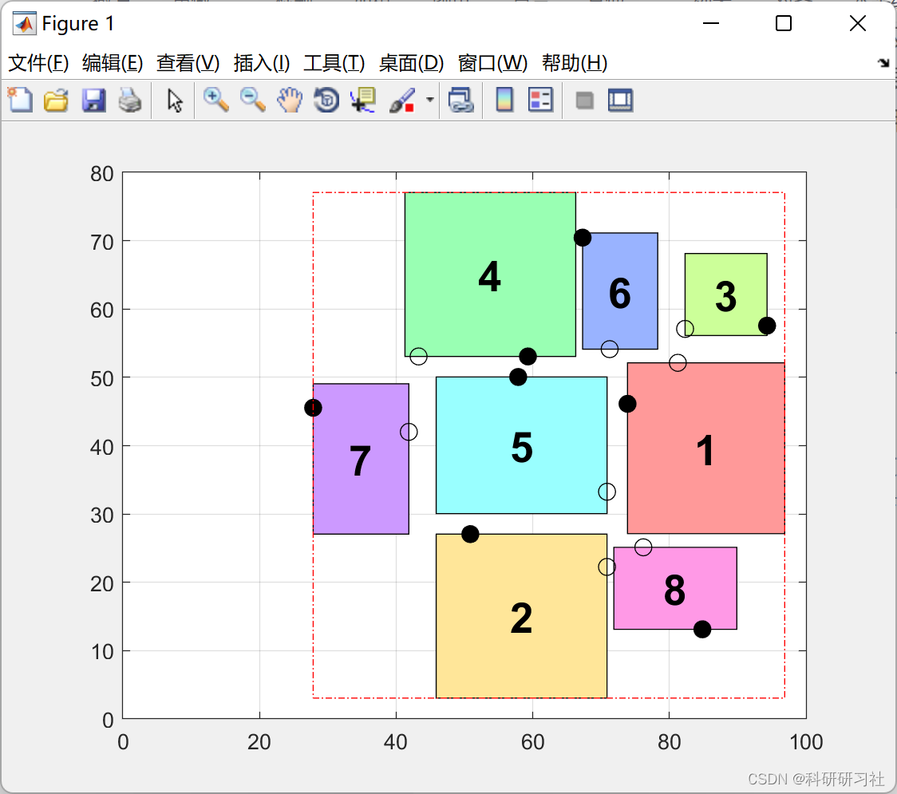
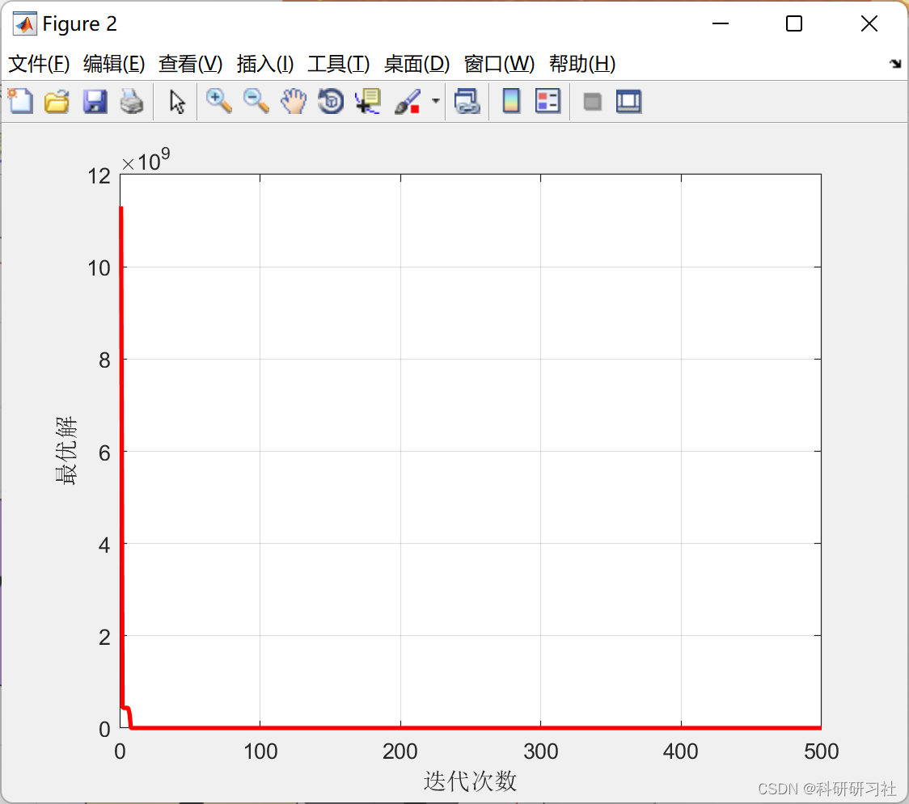

# Research on Device Layout Design Based on Particle Swarm Optimization Algorithm (Matlab Code Implementation)

​  
This paper primarily explores the advantages brought by applying intelligent optimization algorithms in equipment layout design. Firstly, it introduces relevant intelligent optimization algorithms to help gain a deep understanding of their origins and working principles. Subsequently, through the introduction of concepts related to equipment layout design, the paper deepens its understanding of the issues that need to be addressed in this area. Finally, the paper demonstrates the advantages of intelligent optimization algorithms in solving problems in equipment layout design through an example of the application of the Particle Swarm Optimization algorithm. The key factors in equipment layout design are the positioning of equipment and the size of the site. Equipment layout design is a spatial organization problem, whereby devices are arranged and matched through calculation to complete the loop of the production chain, reduce the occurrence of industrial waste, increase product utilization, enhance production efficiency, save on production costs, and maximize the economic benefits of manufacturing enterprises.
3. Running results editing
This article only displays a portion of the code, and for the full code and the article, please click the link.
Research on the design of equipment layout based on Particle Swarm Optimization Algorithm (Matlab code implementation)
5 Conclusions With the continuous and significant advancements in China's science and manufacturing industry, the demands and pressures placed on manufacturing systems have become more severe than before. Technology has enabled intelligent optimization algorithms to assist in the faster and more accurate calculation of equipment layouts within this process. Therefore, this paper thoroughly investigates the role and advantages of applying intelligent optimization algorithms in the design of layouts.
​  

## Images

<!-- PAYMENT_BLOCK -->

## Get this dataset

- Payment link (Stripe): [Buy now](https://buy.stripe.com/3cs8yP7sY87d0vu9AB)
- Payment QR code: 

<!-- /PAYMENT_BLOCK -->
